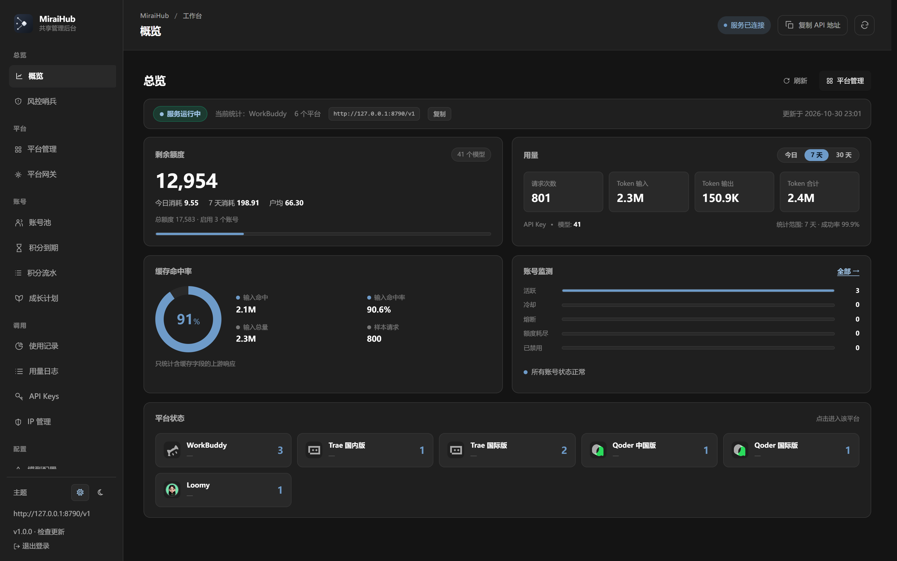
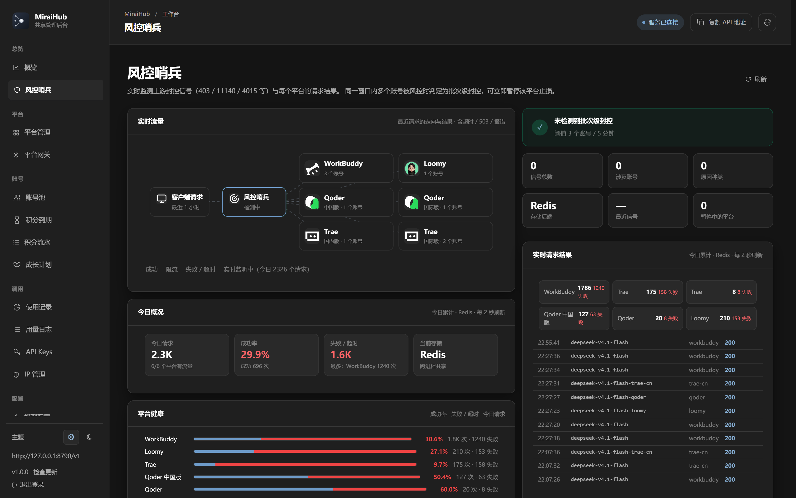
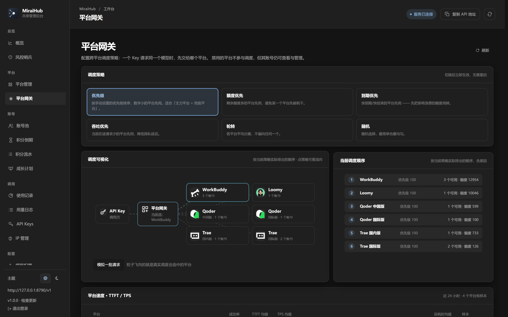
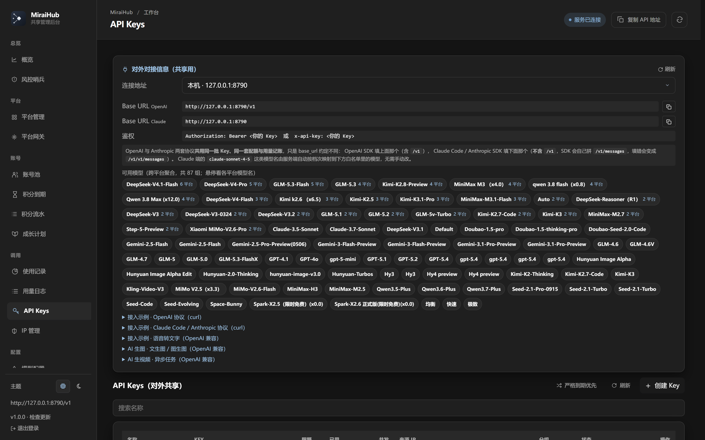
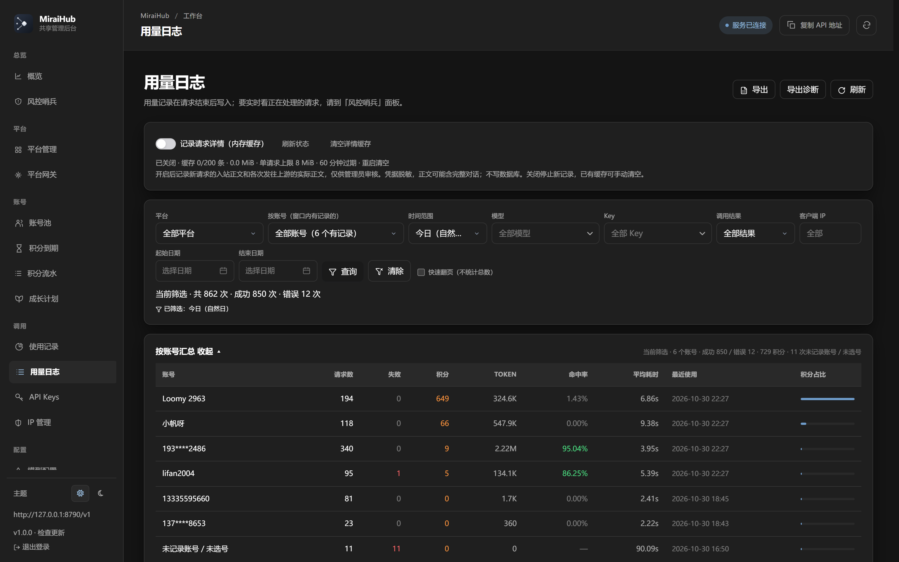
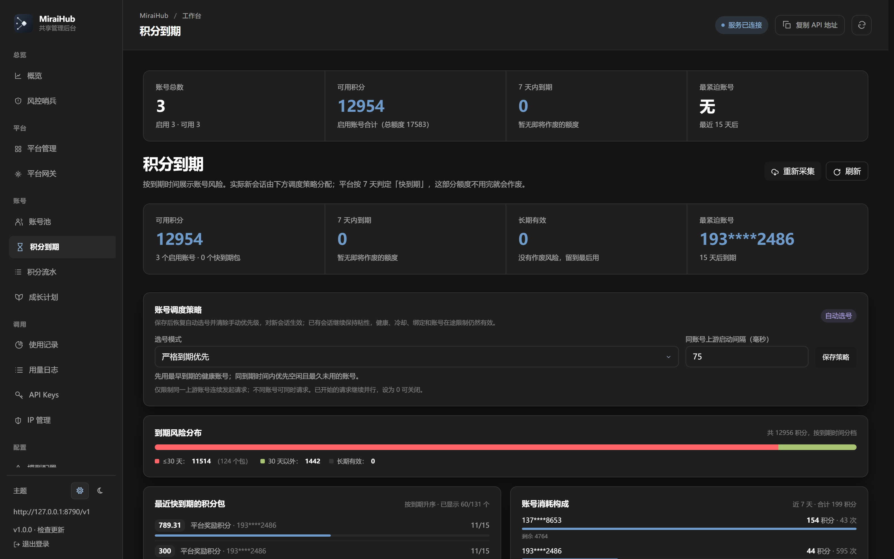

# MiraiHub

> **把多个上游平台，聚合成一个标准的 OpenAI 兼容网关。**

一个 API Key，调用多家上游；一套协议，覆盖所有模型。
自带账号池、配额计费、风控哨兵与实时监控 —— 开箱即用，不需要外部中间件。

---

## 它解决什么问题

手上有好几家平台的账号和额度，但它们：

- 协议各不相同（有的只认 Chat Completions，有的只认自己的私有端点）
- 额度各自到期，用不完就作废
- 单号容易被限流，多号又要自己管轮转
- 客户端只支持一种协议，换个平台就得换工具

**MiraiHub 的做法：把它们全部收进一个网关，对外只暴露标准协议。**

```
                     ┌──────────────────────────────┐
   你的客户端         │          MiraiHub            │      上游平台
  ─────────────      │  ┌────────────────────────┐  │   ──────────────
  OpenAI SDK   ──►   │  │  /v1/chat/completions  │  │──► WorkBuddy
  Anthropic    ──►   │  │  /v1/responses         │  │──► Trae 国内版
  Codex CLI    ──►   │  │  /v1/messages          │  │──► Trae 国际版
                     │  └────────────────────────┘  │──► Qoder
                     │   统一鉴权 · 选号 · 计费      │──► Qoder 国际版
                     │   调度 · 重试 · 记账 · 监控    │──► Loomy
                     └──────────────────────────────┘
```

对外**只有一套 Key 和一套协议**；对内自动选平台、选账号、换号重试、按倍率记账。



---

## 核心玩法：网关就是一个可扩展的平台容器

MiraiHub 不是「写死几个平台的代理」，而是**一个可以不断往里加平台的网关容器**。

### 加一个平台要做的事

```
admin/platform/<你的平台>/
  __init__.py            登记 PlatformSpec（id / 标签 / 网关入口 / 存储平台 / 区域）
  gateway.py             实现转发（chat / responses / messages / models / balance）
  platform_gateway.py    实现管理契约（账号池 11 项操作 / 任务 / 客户端探测）
  core/                  纯协议层（上游客户端 / 指纹 / 目录 / 协议转换）
  services/              状态层（选号 / 额度 / 记账 / 目录同步）
  routers/               /api/<平台>/* 后台接口
```

**框架层不用改一行。** 这是刻意的设计约束：

| 问题 | 是 → | 否 → |
|---|---|---|
| 它认识具体平台吗？（代码里出现平台名） | 平台模块 | 框架层 |
| 新增平台时要改它吗？ | 平台模块 | 框架层 |
| 删掉某个平台后它还成立吗？ | 框架层 | 平台模块 |

违反这条边界的典型后果：加平台时碰坏了已有平台；一个平台被封，其它平台跟着挂；想删掉某个平台，发现逻辑散落在十几个文件里。

### 已经有完整的方法论文档

`admin/platform/skill/` 是一份**可直接交给 AI 或新人执行**的接入规范：

| 文档 | 解决什么 |
|---|---|
| [SKILL.md](admin/platform/skill/SKILL.md) | 职责边界、目录结构、Gateway 契约、**架构真相（谁是主网关）** |
| [ONBOARDING.md](admin/platform/skill/ONBOARDING.md) | 新平台接入全流程 |
| [ENDPOINT-FIRST.md](admin/platform/skill/ENDPOINT-FIRST.md) | **先定端点再谈参数** —— 4023「模型不存在」其实是端点错了 |
| [PKCE-AUTH.md](admin/platform/skill/PKCE-AUTH.md) | 浏览器授权登录（PKCE）通用骨架 |
| [FIXED-BUGS.md](admin/platform/skill/FIXED-BUGS.md) | **30+ 条真实 bug 档案**，每条都有现象 / 根因 / 修法 / 验证 |
| [BILLING.md](admin/platform/skill/BILLING.md) | 倍率与积分口径 |
| [CAPABILITY-MATRIX.md](admin/platform/skill/CAPABILITY-MATRIX.md) | 各平台能力对照（流式 / 工具 / 推理 / 图片） |

配套脚本：

```bash
python admin/platform/skill/scripts/recon.py            # 侦察一个平台
python admin/platform/skill/scripts/probe.py            # 探针验证端点
python admin/platform/skill/scripts/scaffold.py         # 生成平台骨架
python admin/platform/skill/scripts/verify_platform.py  # 接入后验收
```

> **这套文档的价值**：`FIXED-BUGS.md` 里每一条都是踩过的坑。
> 比如「某模型客户端能调、网关调不通」，抱着错误端点试了 20 多种参数组合全失败，
> 最后发现**根因是客户端根本不用那个端点**。先读它，能省掉几天。

---

## 特色功能

### 🛡 风控哨兵

实时盯住每一个账号的失败信号，**在账号被封之前先撤**。

- 按错误码聚合（限流 / 鉴权失效 / 模型不存在 / 内容拦截）
- 命中阈值自动熔断该账号，冷却期内不再被选中
- 可视化拓扑：请求 → 哨兵 → 各平台，出问题的那条线会亮红
- 支持手动暂停某个平台止损（**不消耗额度、不打上游**）



### 🎯 多平台调度策略

同一个模型在多个平台都有时，按你选的策略决定落到哪：

| 策略 | 适合场景 |
|---|---|
| **优先级** | 主力平台 + 兜底平台 |
| **额度优先** | 避免某个平台先被耗干 |
| **到期优先** | 先把即将作废的额度用掉 |
| **吞吐优先** | 按当前在途请求数分摊，降低排队延迟 |
| **轮转 / 随机** | 均匀分摊 |

策略可随时切换，**对新会话生效**；已有会话保持粘性，不会中途换平台。



### 🔑 精细化 Key 管理

一个 Key 可以限制到「只能用某几个模型 / 只能走某个平台 / 只能用某几个账号」：

```
分组（group）              → 限定可用模型集合
平台绑定（platform）       → 只能走这一个平台
多账号绑定（account_ids）  → 只能用这几个账号
并发 / 频率上限            → 独立于全局配额
聚合开关（aggregate）      → 是否参与自动选平台
```

配置存进去 *不等于* 生效 —— 每条都有对应验证项（见 skill 的 §7.1）。



### 🔁 三协议互通

| 端点 | 协议 |
|---|---|
| `/v1/chat/completions` | OpenAI Chat Completions |
| `/v1/responses` | OpenAI Responses |
| `/v1/messages` | Anthropic Messages |
| `/v1/models` · `/v1/balance` | 模型目录 / 余额 |

上游不管支持哪种，网关负责转换。**工具调用（`tool_calls`）在三条协议上都完整透传** ——
这一点是硬要求：丢了客户端就只收到一个「该调工具了」的空收尾，任务直接卡死。

### 📊 实时监控与准确计量

- **用量日志**：每次调用的模型、账号、TTFT、TPS、token、积分
- **TTFT / TPS 口径对齐 DeepSeek Harness**：
  - `TTFT` = 首个**正文** token（不是首个思考事件）
  - `TPS` = `completion_tokens / (latency - ttft)` —— **解码段**而不是整段
  - 非流式上游算不出速度时显示「—」，不编造数字
- **真流式转发**：上游来一帧就转一帧，不做「读完整个响应再切块」的伪流式



### 🖥 桌面版 / Android

- Windows 桌面版（pywebview）：双击即用，内置托盘与版本更新
- Android：同一套后端，账号池 + `/v1` 网关

---

## 快速开始

### 方式一：桌面版（最省事）

从 [Releases](https://github.com/xiaofan6ya/MiraiHub/releases) 下载
`miraihub-<version>-windows-x64.exe`，双击运行。

首次启动会自动创建数据目录、生成管理员密码，并打开工作台。

### 方式二：源码运行

```bash
git clone https://github.com/xiaofan6ya/MiraiHub.git
cd MiraiHub
pip install -r requirements.txt
cp .env.example .env        # 至少设置 ADMIN_PASSWORD
python main.py
```

启动后：

- 管理后台 `http://127.0.0.1:8790/admin`
- 网关入口 `http://127.0.0.1:8790/v1`

> 数据与日志默认在项目目录下的 `data/` 与 `logs/`。
> 数据库支持 SQLite（默认）与 MySQL（`ADMIN_DATABASE_URL`）。

---

## 用起来

### 1. 导入账号

工作台 →「账号池」→ 按平台导入（本机扫描 / 授权登录 / 粘贴凭证）。
每个平台可以放多个账号，网关自动轮转。

### 2. 创建 Key

工作台 →「API Keys」→ 新建。可选的精细化配置见上文「精细化 Key 管理」。

### 3. 调用

```python
from openai import OpenAI

client = OpenAI(
    base_url="http://127.0.0.1:8790/v1",
    api_key="sk-你的Key",
)

resp = client.chat.completions.create(
    model="deepseek-v4.1-flash",      # 不带后缀 = 自动选平台
    messages=[{"role": "user", "content": "你好"}],
)
print(resp.choices[0].message.content)
```

**指定平台**（在模型名后加后缀）：

```python
model="deepseek-v4.1-flash-trae-cn"   # 只用 Trae 国内版
model="deepseek-v4.1-flash-loomy"     # 只用 Loomy
```

**Anthropic 协议**：

```python
import anthropic

client = anthropic.Anthropic(base_url="http://127.0.0.1:8790", api_key="sk-你的Key")
```

### 4. 看它跑得怎么样

- 「用量日志」：每次调用的明细 + 实时刷新
- 「风控哨兵」：进行中的请求、平台健康、自动熔断
- 「使用记录」：按平台 / 模型 / Key / 端点的用量分布
- 「积分到期」：哪些额度快作废，配合「到期优先」策略消化



---

## 目录结构

```
MiraiHub/
├── main.py                  启动入口（管理后台 + 网关同进程）
├── admin/                   框架层 —— 网关本体
│   ├── routers/proxy.py     /v1/* 实现（鉴权 / 选号 / 重试 / 记账）
│   ├── platform/            平台容器
│   │   ├── registry.py      PlatformSpec 注册表 + 选择器解析
│   │   ├── dispatch.py      /v1/* 分叉中间件（唯一的平台判断点）
│   │   ├── gateway_router.py 跨平台调度策略
│   │   ├── sentinel*.py     风控哨兵
│   │   ├── workbuddy/       ┐
│   │   ├── trae/            │
│   │   ├── qoder/           ├ 各平台模块（可整目录删除）
│   │   └── loomy/           ┘
│   └── console/             管理后台前端
├── desktop/                 Windows 桌面版（pywebview）
├── android/                 Android 壳
├── scripts/                 构建与运维脚本
└── admin/platform/skill/    ★ 平台接入方法论（先读这个）
```

> **`admin/` 就是网关本体。** 它不是某个平台的附属：
> `/v1/*` 由 `admin/routers/proxy.py` 实现，`workbuddy` 只是内置默认平台
> （它的上游地址恰好是某个外部域名）。详见 skill 的 §2.5。

---

## 支持的平台

| 平台 | 标识 | 说明 |
|---|---|---|
| WorkBuddy | `workbuddy` | 内置默认平台 |
| Trae 国内版 | `trae-cn` | 与国际版独立凭证 / 目录 |
| Trae 国际版 | `trae-intl` | |
| Qoder 中国版 | `qoder` | |
| Qoder 国际版 | `qoder-intl` | |
| Loomy | `loomy` | 按 token 计量 |

接入新平台请读 [admin/platform/skill/SKILL.md](admin/platform/skill/SKILL.md)，
**不要改 `admin/` 根目录的文件**。

---

## 配置

主要环境变量（完整列表见 `.env.example`）：

| 变量 | 默认 | 说明 |
|---|---|---|
| `ADMIN_HOST` / `ADMIN_PORT` | `0.0.0.0` / `8790` | 监听地址 |
| `ADMIN_DATABASE_URL` | `sqlite:///data/miraihub.db` | 数据库；MySQL 用 `mysql+pymysql://...` |
| `ADMIN_USERNAME` / `ADMIN_PASSWORD` | — | 管理后台账号 |
| `ADMIN_JWT_SECRET` | 自动生成 | 会话签名密钥 |
| `ADMIN_GATEWAY_REQUEST_TIMEOUT` | `300` | 单请求端到端硬上限（秒） |
| `ADMIN_STREAM_IDLE_TIMEOUT` | `300` | 上游读空闲上限，**必须 ≥ 总时限** |
| `ADMIN_POOL_MAX_IN_FLIGHT` | `3` | 单账号并发上限（真正的背压手段） |
| `ADMIN_GATEWAY_MAX_CONCURRENT` | `4` | 全局并发上限 |

> 超时相关的两个值**必须一起看**：读空闲小于总时限时，上游会先于总时限掐断流，
> 客户端只看到半截内容，很难与上游故障区分。

---

## 常见问题

**Q：调用报「模型不存在」，但官方客户端能用？**

先读 [ENDPOINT-FIRST.md](admin/platform/skill/ENDPOINT-FIRST.md)。
多半不是模型名错，而是**端点错了** —— 某些平台的 Agent 类模型必须走专门端点，
走通用端点的错误码恰好是「模型不存在」，极具误导性。

**Q：任务跑到一半停了，只有思考没有下文？**

90% 是 `max_tokens` 太小，思考链把预算吃光，导致正文被截。
推理型模型需要按输入复杂度给足预算（见 FIXED-BUGS 五·补9）。

**Q：TPS 显示「—」？**

非流式上游无法测出解码速度，显示「—」是设计如此 —— 不给假数字。
若明明是流式却没数据，检查是否真的做了流式转发（见 FIXED-BUGS 五·补13）。

**Q：改了配置不生效？**

1. 确认服务真的重启了（`main.py` 会拉子进程，只 kill 父进程无效）
2. 部分配置有缓存，详见 FIXED-BUGS 1.3

---

## 许可

见 [LICENSE](LICENSE)。
