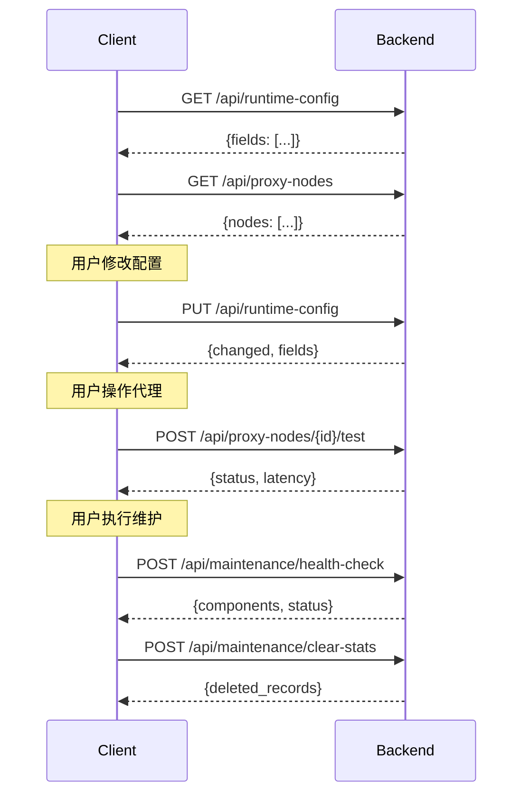

# 功能契约：设置与维护页（Settings & Maintenance）

**页面标识**: P9（TABS 第九个）  
**入口函数**: `loadRuntimeConfig()`、`loadProxyNodes()`  
**路由**: 应用启动时加载，或点击导航栏「设置」/ 「维护与备份」

---

## 一、页面整体结构

```
┌─ 页面标题（「设置与维护」）+ 标签切换器
│  ├─ 「设置」标签
│  └─ 「维护与备份」标签
│
├─ [「设置」标签] ─────────────────────────────
│  ├─ 通用设置区块（collapsible）
│  │  ├─ 平台列表排序（拖拽排序或上下按钮）
│  │  ├─ 默认平台（下拉选择）
│  │  ├─ 时区（下拉选择，UTC±N）
│  │  └─ 语言（下拉选择，中文/English）
│  │
│  ├─ 高级设置区块（collapsible，默认折叠）
│  │  ├─ 分组分类
│  │  │  ├─ 网关与超时
│  │  │  │  ├─ 网关总时限（秒）- 滑块/数字输入
│  │  │  │  ├─ 排队等待上限（秒）- 滑块/数字输入
│  │  │  │  ├─ 上游连接超时（秒） - 滑块/数字输入
│  │  │  │  ├─ 流式静默超时（秒） - 滑块/数字输入
│  │  │  │  └─ ... 其他网关配置
│  │  │  │
│  │  │  ├─ 并发与账号池
│  │  │  │  ├─ 单账号并发上限 - 数字输入
│  │  │  │  ├─ 会话粘性路由 - 切换
│  │  │  │  ├─ 每 Key 并发上限 - 数字输入
│  │  │  │  └─ ... 其他并发配置
│  │  │  │
│  │  │  ├─ 冷却与退避
│  │  │  │  ├─ 软限流冷却基数（秒） - 数字输入
│  │  │  │  ├─ 连续失败熔断阈值 - 数字输入
│  │  │  │  └─ ... 其他限流配置
│  │  │  │
│  │  │  ├─ 登录与安全
│  │  │  │  ├─ 登录失败锁定阈值 - 数字输入
│  │  │  │  ├─ 计数窗口（秒） - 数字输入
│  │  │  │  ├─ 可信代理 IP 列表 - 文本区域
│  │  │  │  └─ 开放 API 文档 - 切换
│  │  │  │
│  │  │  ├─ Anthropic /v1/messages
│  │  │  │  ├─ harness 脱敏 - 切换
│  │  │  │  ├─ opus 档映射模型 - 文本输入
│  │  │  │  └─ ... 其他模型映射
│  │  │  │
│  │  │  ├─ 保活与封号复核
│  │  │  │  ├─ token 保活 - 切换
│  │  │  │  ├─ 保活账号间隔（秒） - 数字输入
│  │  │  │  └─ 封号自动复核 - 切换
│  │  │  │
│  │  │  └─ 记录与上游
│  │  │     ├─ 记录请求载荷 - 切换
│  │  │     ├─ 无回传时的积分系数 - 数字输入
│  │  │     └─ ... 其他日志配置
│  │  │
│  │  └─ 字段信息提示（Tooltip）
│  │     ├─ 标签 + 描述
│  │     ├─ 当前值 + 默认值对比
│  │     └─ 是否需要重启的标记
│  │
│  ├─ 页代理节点管理区块（collapsible）
│  │  ├─ 节点列表（表格）
│  │  │  ├─ 节点名称 / 类型 / 状态 / 操作
│  │  │  ├─ 状态指示（✓ 在线 / ⏸ 暂停 / ✕ 离线）
│  │  │  ├─ 操作
│  │  │  │  ├─ 编辑
│  │  │  │  ├─ 测试连接
│  │  │  │  ├─ 暂停 / 恢复
│  │  │  │  └─ 删除
│  │  │  │
│  │  │  └─ 底部操作按钮
│  │  │     └─ 「+ 添加代理节点」
│  │  │
│  │  └─ 空状态：「暂无代理节点」
│  │
│  ├─ 日志级别设置区块
│  │  ├─ 全局日志级别（下拉选择）
│  │  │  ├─ DEBUG
│  │  │  ├─ INFO
│  │  │  ├─ WARNING
│  │  │  └─ ERROR
│  │  │
│  │  └─ 模块级日志覆盖（可选）
│  │     ├─ 模块名 - 日志级别
│  │     └─ 添加 / 删除行
│  │
│  └─ 操作按钮行
│     ├─ 「重置为默认值」- 仅显示有修改时
│     ├─ 「取消」
│     └─ 「保存设置」
│
├─ [「维护与备份」标签] ──────────────────────
│  ├─ 系统状态区块
│  │  ├─ 系统健康度指示
│  │  │  ├─ 心跳 / 可用性
│  │  │  ├─ 数据库连接状态
│  │  │  ├─ 缓存状态
│  │  │  ├─ 消息队列状态
│  │  │  └─ 「检查健康度」按钮（刷新状态）
│  │  │
│  │  └─ 状态详情面板
│  │     ├─ 最后检查时间
│  │     ├─ 各组件状态 OK / 警告 / 离线
│  │     └─ 详细诊断信息（可展开）
│  │
│  ├─ 维护工具区块
│  │  ├─ 清空统计数据
│  │  │  ├─ 描述：「清空所有使用统计（请求数、Token 数等）」
│  │  │  ├─ 范围选择
│  │  │  │  ├─ ◯ 全部清空
│  │  │  │  ├─ ◯ 仅清空当前平台
│  │  │  │  └─ ◯ 按日期范围清空
│  │  │  │
│  │  │  └─ 「执行清空」按钮（危险操作，二次确认）
│  │  │
│  │  ├─ 数据备份
│  │  │  ├─ 备份范围选择
│  │  │  │  ├─ ☑ 账号数据
│  │  │  │  ├─ ☑ 配置文件
│  │  │  │  ├─ ☑ 操作日志
│  │  │  │  └─ ☑ 统计数据
│  │  │  │
│  │  │  ├─ 备份目标
│  │  │  │  ├─ ◯ 本地下载
│  │  │  │  ├─ ◯ 云存储（S3/OSS，可选）
│  │  │  │  └─ ◯ 定时备份（可选）
│  │  │  │
│  │  │  └─ 「执行备份」按钮
│  │  │
│  │  ├─ 数据恢复
│  │  │  ├─ 文件上传区域
│  │  │  │  ├─ 拖拽上传 / 点击选择文件
│  │  │  │  └─ 文件格式检查（.zip / .tar.gz）
│  │  │  │
│  │  │  ├─ 恢复范围预览
│  │  │  │  └─ 显示文件内容摘要
│  │  │  │
│  │  │  └─ 「执行恢复」按钮（危险操作，二次确认）
│  │  │
│  │  └─ 缓存清理
│  │     ├─ 缓存类型选择
│  │     │  ├─ ☑ 应用缓存
│  │     │  ├─ ☑ 模型缓存
│  │     │  ├─ ☑ 会话缓存
│  │     │  └─ ☑ 全部缓存
│  │     │
│  │     └─ 「清理缓存」按钮
│  │
│  ├─ 任务日志区块（collapsible）
│  │  ├─ 最近执行的维护任务列表
│  │  │  ├─ 任务名 / 状态 / 执行时间 / 耗时 / 结果
│  │  │  ├─ 分页或无限滚动
│  │  │  └─ 点击可查看详细日志
│  │  │
│  │  └─ 自动刷新（可选）
│  │
│  └─ 操作按钮
│     └─ 「返回」或无（维护完成后自动关闭或返回）
│
└─ 底部
   ├─ 数据更新时间戳
   ├─ 「刷新」按钮
   └─ 操作结果提示（Toast）
```

---

## 二、数据来源与接口

### 2.1 设置接口

#### 获取所有设置配置
```http
GET /api/runtime-config
```

**返回字段**:
```json
{
  "fields": [
    {
      "attr": "GATEWAY_REQUEST_TIMEOUT",
      "label": "网关总时限（秒）",
      "group": "网关与超时",
      "kind": "float",
      "desc": "单个请求的端到端硬上限",
      "min": 1,
      "max": null,
      "step": 1,
      "restart": false,
      "value": 60.0,
      "default": 60.0,
      "overridden": false
    },
    {
      "attr": "MAX_IN_FLIGHT",
      "label": "单账号并发上限",
      "group": "并发与账号池",
      "kind": "int",
      "desc": "0 = 不限；把并发摊到整个池子",
      "min": 0,
      "max": null,
      "step": 1,
      "restart": false,
      "value": 0,
      "default": 0,
      "overridden": false
    },
    // ... 更多字段
  ]
}
```

#### 保存设置
```http
PUT /api/runtime-config
```

**请求体**:
```json
{
  "updates": {
    "GATEWAY_REQUEST_TIMEOUT": 90.0,
    "MAX_IN_FLIGHT": 5,
    "STICKY_ENABLED": true
  }
}
```

**返回**:
```json
{
  "changed": ["GATEWAY_REQUEST_TIMEOUT", "MAX_IN_FLIGHT"],
  "reverted": [],
  "errors": {},
  "fields": [/* 更新后的完整 fields 列表 */]
}
```

### 2.2 代理节点接口

#### 获取代理节点列表
```http
GET /api/proxy-nodes
```

**返回**:
```json
{
  "nodes": [
    {
      "id": "proxy_001",
      "name": "节点 1",
      "type": "http",
      "status": "online",
      "url": "http://proxy1.example.com:8080",
      "last_check": 1700086400,
      "muted": false,
      "created_at": 1700000000
    },
    {
      "id": "proxy_002",
      "name": "节点 2",
      "type": "socks5",
      "status": "offline",
      "url": "socks5://proxy2.example.com:1080",
      "last_check": 1700086300,
      "muted": true,
      "created_at": 1699900000
    }
  ]
}
```

#### 更新代理节点
```http
PUT /api/proxy-nodes/{node_id}
```

**请求体**:
```json
{
  "name": "节点 1 新名字",
  "type": "http",
  "url": "http://proxy1-new.example.com:8080"
}
```

#### 测试代理节点
```http
POST /api/proxy-nodes/{node_id}/test
```

**返回**:
```json
{
  "ok": true,
  "data": {
    "latency_ms": 125,
    "status": "online",
    "message": "连接正常"
  }
}
```

#### 切换代理节点暂停状态
```http
POST /api/proxy-nodes/{node_id}/mute
```

**返回**:
```json
{
  "ok": true,
  "data": { "muted": true }
}
```

#### 删除代理节点
```http
DELETE /api/proxy-nodes/{node_id}
```

### 2.3 维护接口

#### 系统健康检查
```http
POST /api/maintenance/health-check
```

**返回**:
```json
{
  "ok": true,
  "data": {
    "status": "healthy",
    "checked_at": 1700086400,
    "components": {
      "heartbeat": {
        "status": "ok",
        "latency_ms": 10
      },
      "database": {
        "status": "ok",
        "connections": 15,
        "max_connections": 100
      },
      "cache": {
        "status": "ok",
        "memory_mb": 256,
        "max_memory_mb": 1024
      },
      "queue": {
        "status": "ok",
        "pending_tasks": 5
      }
    },
    "issues": []
  }
}
```

#### 清空统计数据
```http
POST /api/maintenance/clear-stats
```

**请求体**:
```json
{
  "scope": "all",  // "all" | "platform" | "range"
  "platform": "openai",  // 仅当 scope="platform" 时需要
  "start_date": "2024-10-01",  // 仅当 scope="range" 时需要
  "end_date": "2024-10-31"
}
```

**返回**:
```json
{
  "ok": true,
  "data": {
    "deleted_records": 1250,
    "message": "已清空统计数据"
  }
}
```

#### 执行备份
```http
POST /api/maintenance/backup
```

**请求体**:
```json
{
  "targets": ["accounts", "config", "logs", "stats"],
  "destination": "local"  // "local" | "s3" | "oss"
}
```

**返回**:
```json
{
  "ok": true,
  "data": {
    "backup_id": "backup_20241110_153042",
    "file_size_mb": 125.5,
    "download_url": "/api/maintenance/backup/backup_20241110_153042/download",
    "created_at": 1700086400,
    "message": "备份已创建"
  }
}
```

#### 上传恢复文件
```http
POST /api/maintenance/restore
Content-Type: multipart/form-data

file: <backup.zip>
scope: "all"  // "all" | "accounts" | "config" | "logs" | "stats"
```

**返回**:
```json
{
  "ok": true,
  "data": {
    "restored_records": 850,
    "message": "数据已恢复"
  }
}
```

#### 清理缓存
```http
POST /api/maintenance/clear-cache
```

**请求体**:
```json
{
  "types": ["app", "model", "session"]  // "app" | "model" | "session" | "all"
}
```

**返回**:
```json
{
  "ok": true,
  "data": {
    "freed_memory_mb": 512,
    "message": "缓存已清理"
  }
}
```

#### 获取维护任务日志
```http
GET /api/maintenance/tasks?limit=50&offset=0
```

**返回**:
```json
{
  "tasks": [
    {
      "task_id": "task_20241110_001",
      "name": "清空统计",
      "status": "completed",  // "pending" | "running" | "completed" | "failed"
      "started_at": 1700086000,
      "completed_at": 1700086120,
      "duration_seconds": 120,
      "result": {
        "affected_records": 1250,
        "message": "成功清空统计数据"
      },
      "error": null
    }
  ],
  "total": 150
}
```

---

## 三、数据展示规范

### 3.1 配置字段分组

根据 `runtime_settings.py` 中的 CATALOG，配置分为 7 大组，每组在高级设置中用可折叠的卡片展示。

#### 字段类型与输入组件

| 类型 | 组件 | 示例 |
|------|------|------|
| `bool` | 切换开关 | `STICKY_ENABLED` - ON/OFF |
| `int` | 数字输入 / 滑块 | `MAX_IN_FLIGHT` - 0～999 |
| `float` | 数字输入 / 滑块 | `GATEWAY_REQUEST_TIMEOUT` - 1.0～300.0 |
| `str` | 文本输入 / 文本区域 | `TRUSTED_PROXY_IPS` - 多行可选 |

#### 验证与提示

- 超出范围（min/max）：显示红色边框 + 错误提示
- 类型错误：清空输入，显示「请输入有效的 {类型}」
- 修改时显示「是否需要重启」标记（`restart: true`）

### 3.2 代理节点状态指示

| 状态 | 图标 | 颜色 | 说明 |
|------|------|------|------|
| `online` | ✓ | 绿色 | 正常在线 |
| `offline` | ✕ | 红色 | 离线/不可达 |
| `unknown` | ◯ | 灰色 | 未检查 |

节点行右侧显示「暂停」或「恢复」按钮（取决于 `muted` 状态）。

### 3.3 时间格式

- **登录 / 检查时间**：`fmtTime(s, withSec)` → `YYYY-MM-DD HH:mm:ss`
- **相对时间**（最后检查）：「N 分钟前」/ 「N 小时前」/ 「N 天前」
- **耗时**：秒级显示，如 `2.5s` / `120s`

### 3.4 健康度指示

系统状态用分量表示：

```
系统健康度
├─ 心跳     ✓ OK (10ms)
├─ 数据库   ✓ OK (15/100 连接)
├─ 缓存     ◯ 警告 (256MB / 1024MB)
└─ 消息队列 ✕ 离线
```

整体状态：≥ 1 个离线 → 红色「不健康」；≥ 1 个警告 → 黄色「需注意」；全部 OK → 绿色「健康」。

---

## 四、交互与行为

### 4.1 页面加载

**首次进入「设置」标签**:
1. 显示加载状态
2. 调用 `GET /api/runtime-config`
3. 调用 `GET /api/proxy-nodes`
4. 渲染所有配置字段和代理节点列表
5. 记录初始状态（用于「重置」和对比）

**首次进入「维护与备份」标签**:
1. 显示加载状态
2. 调用 `POST /api/maintenance/health-check`
3. 调用 `GET /api/maintenance/tasks?limit=20`
4. 渲染系统状态和任务日志

### 4.2 设置操作交互

#### 修改配置字段

**步骤**:
1. 用户输入 / 切换 / 选择新值
2. 实时验证
   - 格式错误（如字符串输入了数字）：显示红色提示
   - 超出范围：显示「不能小于 {min}」/ 「不能大于 {max}」
3. 修改时启用「重置为默认值」按钮和「保存设置」按钮
4. 若字段 `restart: true`，显示黄色警告「修改需要重启生效」

#### 重置为默认值

**触发条件**：
- 有任何字段被修改时显示按钮

**交互流程**:
1. 点击「重置为默认值」
2. 显示确认对话框
   - 标题：「确认重置」
   - 内容：「所有配置将恢复为默认值。」
   - 按钮：「取消」「确认重置」
3. 用户确认后：
   - 所有字段值恢复为 `default` 值
   - 清除所有修改标记
   - 「重置」和「保存」按钮禁用

#### 保存设置

**触发条件**：
- 有配置被修改时，「保存设置」按钮可用

**交互流程**:
1. 点击「保存设置」
2. 再次验证所有修改字段
3. 若有错误，显示 Toast 提示，聚焦第一个错误字段
4. 若验证通过：
   - 发送 `PUT /api/runtime-config` 请求
   - 显示加载状态（按钮禁用，转圈）
   - 请求成功：
     - 显示成功提示：「设置已保存」
     - 更新页面数据（`fields` 列表）
     - 若有字段 `restart: true`，显示信息：「部分配置需要重启应用才能生效」
     - 清除修改标记，禁用「重置」和「保存」按钮
   - 请求失败：
     - 显示错误提示：「保存失败：{error}」
     - 用户可重试

### 4.3 代理节点操作

#### 编辑代理节点

**流程**:
1. 点击节点行的「编辑」按钮
2. 弹出编辑对话框或展开编辑表单
   - 字段：名称、类型、URL
   - 验证：URL 格式
3. 修改后点击「保存」
   - 发送 `PUT /api/proxy-nodes/{node_id}`
   - 成功后刷新列表

#### 测试连接

**流程**:
1. 点击「测试连接」按钮
2. 显示测试进行中（按钮禁用，转圈）
3. 发送 `POST /api/proxy-nodes/{node_id}/test`
4. 显示结果：
   - 成功：「连接正常 (125ms)」（绿色）
   - 失败：「无法连接」（红色）+ 详细错误

#### 暂停 / 恢复

**流程**:
1. 点击「暂停」或「恢复」按钮
2. 发送 `POST /api/proxy-nodes/{node_id}/mute`
3. 节点状态立即更新（乐观更新）
4. 若失败，回滚状态并显示错误提示

#### 删除代理节点

**流程**:
1. 点击「删除」按钮
2. 显示确认对话框
   - 标题：「确认删除」
   - 内容：「删除后将无法使用该代理节点。」
   - 按钮：「取消」「确认删除」
3. 用户确认后：
   - 发送 `DELETE /api/proxy-nodes/{node_id}`
   - 成功：从列表移除，显示 Toast 提示
   - 失败：显示错误提示

#### 添加代理节点

**流程**:
1. 点击「+ 添加代理节点」按钮
2. 弹出新建对话框或展开新建表单
   - 字段：名称、类型、URL
3. 填写后点击「创建」
   - 发送 `POST /api/proxy-nodes`（新增接口，待定）
   - 成功：新节点出现在列表，显示「已添加」提示
   - 失败：显示错误，保留表单

### 4.4 维护与备份操作

#### 检查系统健康度

**流程**:
1. 点击「检查健康度」按钮
2. 显示检查进行中（按钮禁用，转圈）
3. 发送 `POST /api/maintenance/health-check`
4. 更新状态面板
   - 刷新「最后检查时间」
   - 更新各组件状态指示
   - 若有问题组件，高亮显示

#### 清空统计数据

**流程**:
1. 选择清空范围（全部 / 仅当前平台 / 日期范围）
2. 点击「执行清空」按钮
3. 显示二次确认对话框
   - 标题：「确认清空统计」
   - 内容：「将清空选中范围的所有统计数据（请求数、Token 数等）。此操作不可撤销。」
   - 按钮：「取消」「我知道了，清空」
4. 用户确认后：
   - 发送 `POST /api/maintenance/clear-stats`
   - 显示进度条或加载动画
   - 成功：显示「已清空 N 条记录」+ 任务出现在日志列表
   - 失败：显示错误提示，用户可重试

#### 执行备份

**流程**:
1. 选择备份范围（账号数据、配置、日志、统计等）
2. 选择备份目标（本地下载 / 云存储）
3. 点击「执行备份」按钮
4. 显示备份进行中（进度条）
5. 成功：
   - 若目标是「本地下载」，自动触发下载 `backup_YYYYMMDD_HHmmss.zip`
   - 显示成功提示 + 文件大小
   - 任务出现在日志列表
6. 失败：显示错误提示

#### 执行恢复

**流程**:
1. 拖拽或点击选择备份文件（.zip 或 .tar.gz）
2. 显示文件验证进行中
3. 验证成功：显示恢复范围预览（即将恢复的数据摘要）
4. 点击「执行恢复」按钮
5. 显示二次确认对话框
   - 标题：「确认恢复数据」
   - 内容：「现有数据将被备份文件覆盖。此操作不可撤销。」
   - 按钮：「取消」「我知道了，恢复」
6. 用户确认后：
   - 发送 `POST /api/maintenance/restore`
   - 显示进度条
   - 成功：显示「已恢复 N 条记录」+ 任务日志
   - 失败：显示错误，原数据保持不变

#### 清理缓存

**流程**:
1. 选择要清理的缓存类型（应用 / 模型 / 会话 / 全部）
2. 点击「清理缓存」按钮
3. 确认对话框（可选，非危险操作）
4. 发送 `POST /api/maintenance/clear-cache`
5. 成功：显示「已释放 XXX MB 内存」

---

## 五、确认对话框规范

### 通用对话框样式

```
┌──────────────────────────────────┐
│ ✕                                │
│                                  │
│ [⚠] 确认操作                     │
│                                  │
│ 对话框内容描述。                 │
│                                  │
│    [取消]  [我知道了，确认]      │
└──────────────────────────────────┘
```

**危险操作**（清空、恢复、删除）:
- 确认按钮：红色 Solid
- 文案加重：「我知道了，X」

**普通操作**（重置、编辑）:
- 确认按钮：蓝色 Solid
- 文案：「确认」

---

## 六、边界情况与容错

### 6.1 数据缺失或异常

| 情况 | 处理 |
|------|------|
| 配置字段返回值为 null | 显示默认值，标记为「未配置」|
| 配置值超出约束 | 显示红色错误，不允许保存 |
| 代理节点列表为空 | 显示「暂无代理节点」，显示「添加」按钮 |
| 节点无法检查状态 | 状态显示「未知」（灰色），提示「点击测试连接」|
| 健康检查无响应 | 显示「检查失败」，保留上次数据 |
| 维护日志为空 | 显示「暂无任务」 |

### 6.2 加载态与错误

**加载中**:
- 配置区块显示骨架屏（字段占位符）
- 节点列表显示表格占位符
- 按钮禁用，显示转圈动画

**请求失败**:
- 显示 Toast 错误提示，包含错误详情
- 保留上次成功的数据
- 操作按钮恢复可用，提供「重试」选项

**响应超时**（> 10 秒）:
- 显示降级视图（上次缓存数据）
- 后台继续重试
- 收到响应后自动更新

### 6.3 权限与校验

**权限检查**:
- 仅 `admin` 角色可访问本页面
- 若无权限，显示「权限不足，请联系管理员」

**输入校验**:
- 配置值必须符合 `kind` 和 `min/max` 约束
- 代理 URL 必须有效（协议 + 主机 + 端口）
- IP 列表必须逐行有效

---

## 七、跨页联动

### 7.1 配置变更同步

- 配置保存后，全局事件 `sb-config-updated` 发送至其他页面
- 其他页面（如「概览」「模型」）收到事件后刷新相关数据

### 7.2 代理节点同步

- 代理节点状态变化（暂停 / 恢复）时，网关实时感知
- 若代理节点被禁用，请求自动转移到其他节点

### 7.3 维护完成通知

- 备份 / 恢复 / 清空完成后，显示 Toast 通知
- 若影响其他页面数据，发送全局刷新事件

---

## 八、边界情况深化

### 8.1 配置冲突

| 冲突情况 | 处理 |
|---------|------|
| `MAX_IN_FLIGHT > GATEWAY_MAX_CONCURRENT` | 警告：「单账号并发超过 Key 并发上限，配置可能无效」|
| `LOGIN_MAX_ATTEMPTS = 0` | 禁用：「不能禁用登录限制」|
| `GATEWAY_REQUEST_TIMEOUT < STREAM_CONNECT_TIMEOUT` | 警告：「请求总超时小于连接超时，可能导致所有请求超时」|

### 8.2 操作恢复

| 操作 | 能否撤销 | 处理 |
|------|---------|------|
| 清空统计 | ✕ | 执行前三次确认，完成后记录到日志 |
| 修改配置 | ✓ | 保存前可重置，保存后需新建版本 |
| 恢复数据 | ✕ | 执行前自动备份现有数据 |
| 删除代理 | ✓（恢复列表）| 被删除的节点在历史日志中可见 |

---

## 九、实现要点

1. **实时验证**：配置字段在修改时立即验证，不等保存
2. **乐观更新**：代理节点操作（暂停、测试）立即更新 UI，失败时回滚
3. **确认对话框**：所有危险操作（清空、恢复、删除）都需二次确认 + 文案强调
4. **分组管理**：高级配置按功能分组，默认折叠，用户按需展开
5. **性能优化**：
   - 配置页加载时一次性获取所有字段（避免逐个请求）
   - 代理节点列表分页或虚拟滚动（若超过 100 个）
   - 维护日志分页加载（首次加载最近 20 条）
6. **无障碍**：
   - 表单字段用 `<label>` 关联
   - 滑块用 `aria-label` 描述
   - 切换用 `role="switch"` + `aria-checked`
   - 确认对话框用 `role="alertdialog"`
7. **国际化**：
   - 所有文案提取到 i18n 配置
   - 数字单位支持本地化（如 MB / MB）
   - 时间格式根据地域调整
8. **主题适配**：
   - 颜色变量用 CSS Custom Properties
   - 状态指示用 `--c-ok`（绿）/ `--c-warn`（黄）/ `--c-danger`（红）
   - 支持亮 / 暗主题切换

---

## 十、API 交互时序



---

## 十一、旧版有但本契约未涉及的功能

| 功能 | 旧版位置 | 新版建议位置 | 状态 |
|------|---------|------------|------|
| 应用源代码管理 | 旧版「设置」标签 | 移到「应用设置」页（新增 P26） | ⏳ |
| 邀请码生成 | 旧版「设置」标签 | 移到「访问控制」页（P18） | ✓ |
| 数据库备份验证 | 旧版「维护」标签 | 本页包含但未详细展开 | ⏳ |
| 模型速率限制微调 | 旧版隐藏在高级设置 | 本页高级设置已涵盖 | ✓ |
| 自定义告警规则 | 旧版「维护」页 | 移到「告警规则」页（新增 P27） | ⏳ |

---

## 实现对照（S28）

> 本节是 S28 的交付说明（原 1–917 行未改动）。实现落在 `admin/ui/src/pages/SettingsPage.vue` +
> `admin/ui/src/api/settings.ts`（+ `tests/page-settings.spec.ts`），按 P23 的 5 个区块与 SettingsLayout（模板 C）实现；
> 每个卡片独立保存。

| 契约功能 | 新版位置 / 真实接口 | 状态 |
|---|---|---|
| 运行配置：每项名称 + 说明 + 控件 | SettingsPage `#settings-runtime`；`GET /api/runtime-config` → `fields[{attr,label,group,kind,desc,min,max,step,restart,value,default,overridden}]`（admin/runtime_settings.py:snapshot） | 已实现 |
| 重启后生效标记 | `field.restart` → Badge warn「重启后生效」 | 已实现（当前 CATALOG 没有 restart=True 的项，标记逻辑就绪） |
| 保存后「有 N 项修改需要重启服务后生效」横幅 | `restartPendingOf()`：保存返回的 `changed` ∩ restart 字段 | 已实现 |
| 运行配置保存（只发改动项；空值 = 回落 .env） | `PUT /api/runtime-config {updates}`（runtime_settings.py:save）→ `changed/reverted/errors` | 已实现（分组按后端 `group`，不硬编码） |
| 出口代理节点 DataTable | `GET /api/proxies` → `items[]` + `summary{total,ready,blocked,disabled,slots}` + `pools[]`（admin/routers/proxies.py:list_proxies） | 已实现 |
| 添加节点 FormDrawer | `POST /api/proxies {label,url,max_concurrency,pool}`；地址在列表恒为 `***`（后端 _mask） | 已实现 |
| 行操作：启停 / 解除静默 / 删除 | `PATCH /api/proxies/{id}`、`POST /{id}/unblock`、`DELETE /{id}`（删除需确认） | 已实现 |
| 代理说明（单 IP 多号会被拉黑、分组去定时任务选） | 卡片说明 + 「定时任务」链到 `/schedules` | 已实现 |
| WorkBuddy 邀请绑定：状态 + 表单 + 停用 | `GET/PUT /api/settings/invitation`（admin/server.py:130/136 → admin/invitation.py）；返回 `invite_code/invite_url/enabled`；停用 = 提交空值（确认） | 已实现 |
| 修改登录密码：前端一致 + 最小长度 | `PATCH /api/admin/password {old_password,new_password}`（server.py:936；后端 ≥6 位并吊销其它会话）；前端先拦「两次不一致」「少于 6 位」 | 已实现 |
| 密码修改成功提示（其它设备需要重新登录） | 用 `revoked_sessions` 显示「已修改，其他设备需要重新登录（吊销 N 个会话）」 | 已实现 |
| 逆向产物：路径 + 校验并保存 + 设为输出目录 | `GET /api/app-source/status`、`POST /locate {install_dir, source_dir}`（admin/routers/app_source.py） | 已实现 |
| 逆向产物：预检 / 一键拆包 / 删除产物 | `POST /unpack/plan`、`POST /unpack`、`POST /remove`；进度 `GET /unpack/progress`（usePolling 1.5s） | 已实现 |
| 逆向产物：检索 + 结果列表 | `GET /api/app-source/search?q=&limit=` → `files[{file,line,text}]`（产物不存在时 reason 原样提示） | 已实现 |
| 开发工具关闭时的降级 | `DEV_TOOLS=0` 时后端整路由 404 → 卡片说明「本部署未开放逆向产物」，不报错 | 已实现 |
| 每卡独立保存 + 未保存标记 + 离开确认 | SettingsCard 的 save/reset + SettingsLayout `:dirty` | 已实现 |
| 四态 + 375px | 各卡骨架 / 保留旧数据 / Empty（无节点、无检索结果）/ ErrorBlock 或卡内错误；单列 | 已实现 |
| 单元测试（真实响应形状 → 分组/重启横幅/密码校验/代理摘要） | admin/ui/tests/page-settings.spec.ts | 已实现 |


